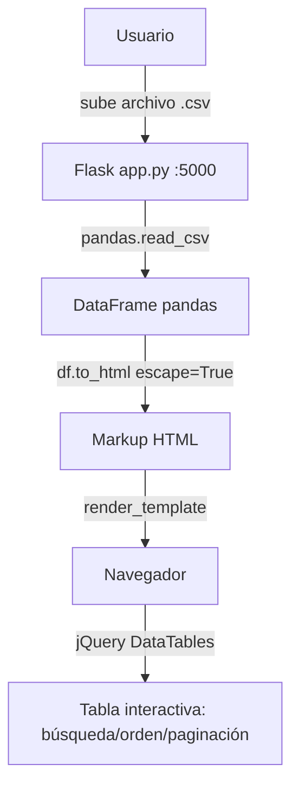

# flask-csv-viewer

Aplicación web Flask que permite subir un archivo CSV y visualizar su contenido como una tabla HTML interactiva usando Pandas y DataTables.

[](https://python.org)
[](https://flask.palletsprojects.com/)
[](https://github.com/bi0punk/flask-csv-viewer/actions/workflows/ci.yml)
[](LICENSE)

## Contenido

- [Características](#características)
- [Arquitectura](#arquitectura)
- [Stack](#stack)
- [Estructura del repositorio](#estructura-del-repositorio)
- [Instalación](#instalación)
- [Uso](#uso)
- [Configuración](#configuración)
- [Seguridad](#seguridad)
- [Tests / CI](#tests--ci)
- [Roadmap](#roadmap)
- [Licencia](#licencia)

## Características

- Subida de archivos CSV con validación de tipo y tamaño
- Renderizado como tabla HTML interactiva con DataTables
- Escapado de celdas via `pandas.to_html(escape=True)` contra XSS
- Límite de subida configurable (16 MB por defecto)

## Arquitectura



## Stack

| Componente | Tecnología |
|---|---|
| Backend | Python 3.11+, Flask 3.0+ |
| Parseo CSV | Pandas 2.0+ |
| Frontend | HTML5 + jQuery DataTables + Bootstrap |
| Testing | pytest + ruff |

## Estructura del repositorio

```
flask-csv-viewer/
├── app.py                  # Aplicación Flask principal
├── templates/
│   └── index.html          # Vista con DataTables
├── data/                   # CSVs de ejemplo
│   └── employees.csv
├── tests/
├── requirements.txt
├── pyproject.toml
├── .env.example
├── .github/workflows/ci.yml
└── README.md
```

## Instalación

Requisitos: Python 3.11+.

```bash
git clone https://github.com/bi0punk/flask-csv-viewer.git
cd flask-csv-viewer
python -m venv .venv && source .venv/bin/activate
pip install -r requirements.txt
```

## Uso

```bash
python app.py
```

Abrir `http://localhost:5000`, seleccionar un archivo CSV y visualizarlo como tabla interactiva con búsqueda, ordenamiento y paginación.

## Configuración

| Variable | Default | Descripción |
|---|---|---|
| `MAX_CONTENT_LENGTH` | 16 MB | Tamaño máximo de subida |
| `FLASK_SECRET` | secreto aleatorio | Clave de sesión de Flask |

## Seguridad

- Los valores de las celdas CSV son escapados por pandas `to_html(escape=True)` antes de renderizar
- Tamaño de subida limitado a 16 MB
- Validación de tipo de archivo (solo extensión `.csv`) y de contenido por el parser de pandas

## Tests / CI

CI: GitHub Actions ejecuta ruff lint + pytest en cada push y PR.

```bash
pip install pytest ruff
pytest -q
ruff check .
```

## Roadmap

- [x] Visor CSV con DataTables
- [ ] Soporte para archivos Excel (.xlsx)
- [ ] Exportación a PDF/JSON desde la tabla
- [ ] Filtros avanzados y gráficos integrados
- [ ] Subida drag & drop

## Licencia

MIT — ver [LICENSE](LICENSE).